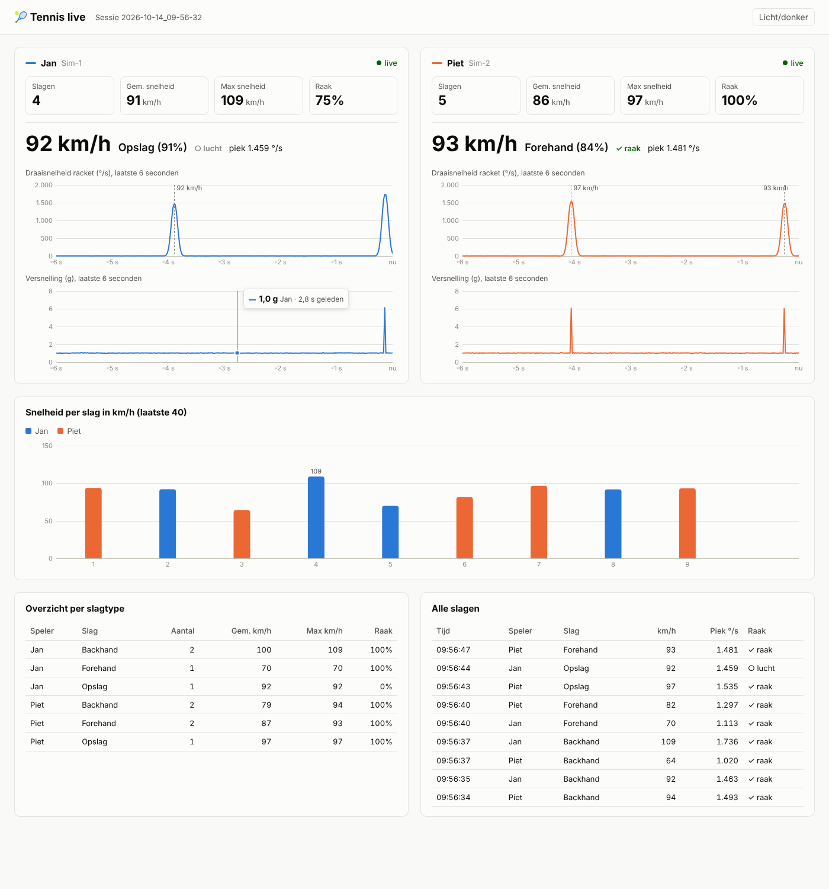

# Tennisslagen analyseren met Thingy:53

Een Thingy:53 op het racket meet elke slag: hoe snel het racket draait, een schatting van
de racketsnelheid in km/h, of je de bal raakte, en welk type slag het was
(forehand / backhand / opslag, na een korte kalibratie).

```
Nu:       Thingy (racket Jan) ──┐
          Thingy (racket Piet) ─┴─Bluetooth──▶ laptop (tennis-tracker)

Later:    Thingy (racket Jan)  ──Bluetooth──▶ Pi 1 ──┐
          Thingy (racket Piet) ──Bluetooth──▶ Pi 2 ──┴─wifi──▶ laptop (collect)
```

Hetzelfde programma (`tennis-tracker`) draait op Windows, macOS, Linux en de Raspberry Pi.

## 1. Firmware op de Thingy's

Bestand: [`firmware/thingy53_tennis/prebuilt/thingy53_tennis_v1.0.0_dfu_application.zip`](../firmware/thingy53_tennis/prebuilt/thingy53_tennis_v1.0.0_dfu_application.zip)

Zet het erop zoals bij de muis: nRF Connect for Desktop → **Programmer**. Zet de Thingy uit,
houd de kleine knop ingedrukt, zet hem aan, kies **Select device**, **Add file**, **Write**.

> Een Thingy heeft één firmware tegelijk. Wil je hem weer als muis gebruiken, zet dan
> `firmware/thingy53/prebuilt/...mouse...zip` er weer op. De muis-firmware is niet veranderd.

LED van de tennis-sensor:
- **blauw knipperend**: wacht op laptop/Pi
- **kort groen knipperen**: verbonden
- **wit knipperen**: "identify" (om te zien welke sensor welke is)
- **cyaan** zolang je de grote knop indrukt: markering (bijv. begin van een oefening)

Elke sensor heeft een eigen naam, bijvoorbeeld `Tennis-3F2A`.

**Bevestigen op het racket:** zet hem stevig vast op de hals (tussen handvat en blad), bijvoorbeeld met
klittenband of tape, en altijd op dezelfde plek en in dezelfde richting. Als hij verschuift, opnieuw kalibreren.

## 2. Op de laptop (Windows)

1. Installeer [Python](https://www.python.org/downloads/) (vink *Add python.exe to PATH* aan).
2. Download deze repo (groene knop **Code → Download ZIP** op GitHub) en pak hem uit.
3. Open een opdrachtprompt in de map `tennis` en installeer:
   ```
   python -m pip install .
   ```
4. Zet de Thingy's aan en zoek ze:
   ```
   tennis-tracker scan
   tennis-tracker identify --sensor Tennis-3F2A      (die knippert dan wit)
   ```
5. **Kalibreer** elke sensor één keer (je slaat per type 5 slagen; vertelt hem welke slag wat is):
   ```
   tennis-tracker calibrate --sensor Tennis-3F2A
   ```
6. **Meten** met twee rackets tegelijk:
   ```
   tennis-tracker run --sensor Tennis-3F2A --player Jan --sensor Tennis-81C4 --player Piet
   ```
   Elke slag verschijnt meteen:
   ```
   10:31:07  Jan        forehand   96%     94 km/h  piek 1493 °/s  RAAK
   10:31:09  Piet       backhand   92%     71 km/h  piek 1130 °/s  lucht
   ```
   Stoppen met **Ctrl+C**; dan krijg je een samenvatting per speler en slagtype.

### Live dashboard



Bij `tennis-tracker run` gaat automatisch je browser open met het **dashboard**
(http://localhost:8000). Daar zie je per racket:
- live grafieken van de draaisnelheid en versnelling (laatste 6 seconden), met elke slag gemarkeerd
- de laatste slag groot in beeld: snelheid, type, raak of lucht
- aantal slagen, gemiddelde en maximale snelheid, raakpercentage
- een staafgrafiek met de snelheid van elke slag (per speler een kleur) en tabellen met alle slagen

Het werkt zonder internet. Beweeg met de muis over een grafiek voor de precieze waarde.
Knop rechtsboven: licht/donker. Zonder dashboard: `--no-dashboard`.

Zonder Thingy uitproberen kan ook: `tennis-tracker run --simulate --count 2`.

### Wat wordt er opgeslagen?

In `sessies/<datum_tijd>/`:
- `slagen.csv`: elke slag (speler, type, snelheid, raak, ...), te openen in Excel
- `ruw_<sensor>.csv`: alle ruwe metingen (200 per seconde) voor eigen analyse
- `markeringen.csv`: momenten waarop de knop op de Thingy is ingedrukt

Samenvatting achteraf: `tennis-tracker report sessies/<datum_tijd>`

## 3. Later: op twee Raspberry Pi's

Op **elke** Pi (Raspberry Pi OS, Pi 3/4/5 of Zero 2 W; Bluetooth zit erin):

```bash
git clone https://github.com/nandhomandotnl/Thingy.git
cd Thingy/tennis
sudo ./pi/install.sh
sudo /opt/tennis-tracker/venv/bin/tennis-tracker scan
cd /var/lib/tennis-tracker && sudo /opt/tennis-tracker/venv/bin/tennis-tracker calibrate --sensor Tennis-3F2A
```

Zet in `/etc/default/tennis-tracker` welke sensor en speler bij deze Pi horen, en het adres van de laptop:

```bash
TENNIS_ARGS="--sensor Tennis-3F2A --player Jan --forward 192.168.1.20:5005"
```

Start met `sudo systemctl restart tennis-tracker` (start daarna ook vanzelf bij het opstarten).
Live meekijken: `journalctl -u tennis-tracker -f`.

Op de **laptop** verzamel je de slagen van beide Pi's:

```
tennis-tracker collect
```

Alle slagen komen live binnen, in het dashboard (http://localhost:8000) en in `sessies/alle_slagen.csv`.

Wil je de live grafieken van een Pi zelf zien, zet dan op die Pi
`--no-browser --dashboard-host 0.0.0.0` in `TENNIS_ARGS` en open op je laptop `http://<ip-van-de-pi>:8000`.
Elke Pi bewaart daarnaast zijn eigen volledige sessie in `/var/lib/tennis-tracker/sessies/`.

## Goed om te weten

- **Snelheid** is een schatting: draaisnelheid × `--radius` (standaard 1,0 m). Vergelijk vooral
  slagen met elkaar; met een radar of video kun je `--radius` bijstellen.
- **Meetbereik** van de sensor is 2000 °/s en 16 g. Heel harde slagen kunnen daarboven komen; die worden
  gemarkeerd ("boven meetbereik") en de snelheid is dan een ondergrens.
- **Raak** wordt bepaald aan de schok in de versnellingsmeter. Is dat te gevoelig of niet gevoelig genoeg,
  laat het weten, dan stellen we `hit_jolt_g` bij.
- Een laptop kan prima twee sensors tegelijk aan. Haal de Thingy's niet verder dan ~10 m van laptop of Pi.

## Code

- `tennis_tracker/protocol.py`: Bluetooth-protocol van de firmware
- `tennis_tracker/sources.py`: echte sensor (bleak) en simulator
- `tennis_tracker/detect.py`: slagherkenning en metingen
- `tennis_tracker/classify.py`: slagtype leren en herkennen
- `tennis_tracker/dashboard.py` + `dashboard.html`: live dashboard in de browser
- `tennis_tracker/storage.py`, `report.py`, `forward.py`, `cli.py`
- Firmware: `../firmware/thingy53_tennis/src/main.c`

Tests: `pip install -e .[test] && pytest`
